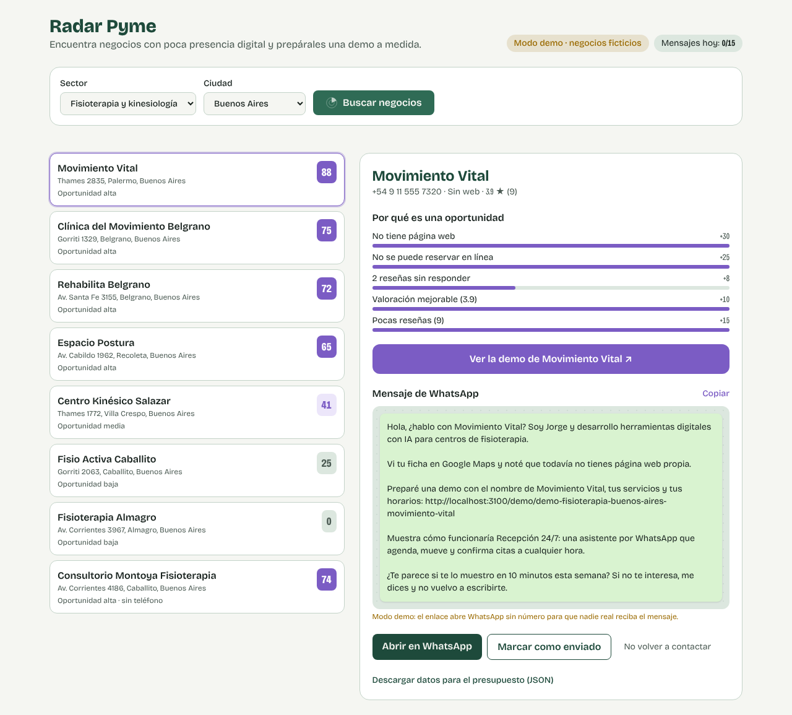
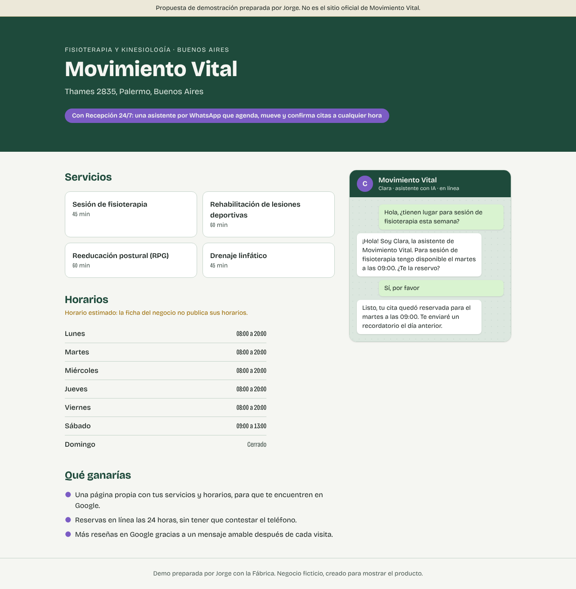

# Radar Pyme · prospección con demo a medida

Demo de la **Fábrica**: módulos reutilizables para construir software para pymes de Latinoamérica.

Eliges un sector y una ciudad. Radar Pyme encuentra los negocios, puntúa su presencia digital (si tienen web,
si se puede reservar en línea, sus reseñas) y, para cada uno, **prepara una demo con su nombre, sus servicios
y sus horarios** más un mensaje de WhatsApp listo para enviar uno a uno. Nunca envíos masivos.



## Pruébalo en 1 minuto

```bash
npm install
npm run dev
```

Abre http://localhost:3000. Sin ninguna clave funciona el **modo demo**: negocios ficticios pero creíbles de
Buenos Aires, Ciudad de México, Bogotá, Lima, Santiago y Montevideo, en seis sectores (fisioterapia, odontología,
estética, gimnasios, restaurantes y reformas).

### Guion para el vídeo de 60 segundos
1. Elige "Fisioterapia y kinesiología" en "Buenos Aires" y pulsa **Buscar negocios**: el radar barre y aparece la lista ordenada.
2. Toca el primero: se ve por qué es una oportunidad (sin web, sin reservas en línea, pocas reseñas).
3. Pulsa **Ver la demo**: su propia página con su nombre, servicios, horarios y su asistente respondiendo por WhatsApp.
4. Vuelve y enseña el mensaje: menciona su punto débil y enlaza a su demo. **Abrir en WhatsApp** y **Marcar como enviado**.
5. Cierra con **Descargar datos para el presupuesto**: el siguiente paso de la Fábrica es el presupuesto en PDF.



## Con Google Places real

Copia `.env.example` a `.env.local`:

- `GOOGLE_PLACES_API_KEY`: clave de Google Cloud restringida a **Places API (New)**. Se usa solo en el servidor.
- `RADAR_TOKEN`: obligatoria con la clave de Google (16+ caracteres). La interfaz la pide antes de buscar. Sin ella, la API se niega.
- `RADAR_URL_PUBLICA`: dominio para los enlaces de las demos (por ejemplo, el de Vercel).
- `RADAR_REMITENTE_NOMBRE`: tu nombre en los mensajes.

Places no informa si el dueño respondió las reseñas: en modo real ese criterio aparece como "sin datos" y no suma puntos.
Ver `AUDITORIA.md` para lo que falta probar antes de usarlo con negocios reales.

## Cómo está hecho

```
src/radar/
  config.ts              lo único que se toca: sectores, ciudades, pesos, límites, firma
  puntuacion.ts          motor de puntuación 0-100, puro y explicable
  fuentes/               demo (determinista) y Google Places API (New)
  almacen.ts             en memoria: un contacto por negocio, tope diario, no contactar
  demo-personalizada.ts  la demo de cada negocio
  mensaje.ts             el mensaje de WhatsApp uno a uno
  presupuesto.ts         EntradaPresupuesto: la salida hacia el presupuesto en PDF
  neutro.ts              detector de voseo y modismos (los tests lo aplican a todo)
src/app/                 interfaz, demo por negocio (/demo/[id]) y API
tests/                   53 tests
```

Stack: Next.js 16, TypeScript estricto, Tailwind 4, Zod, Vitest. CI en GitHub Actions (typecheck, tests, build).
